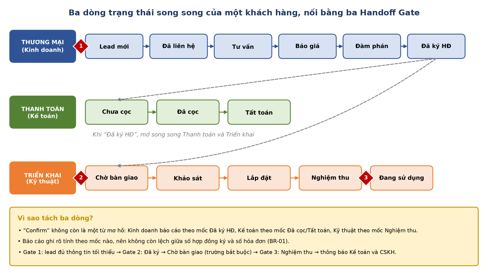
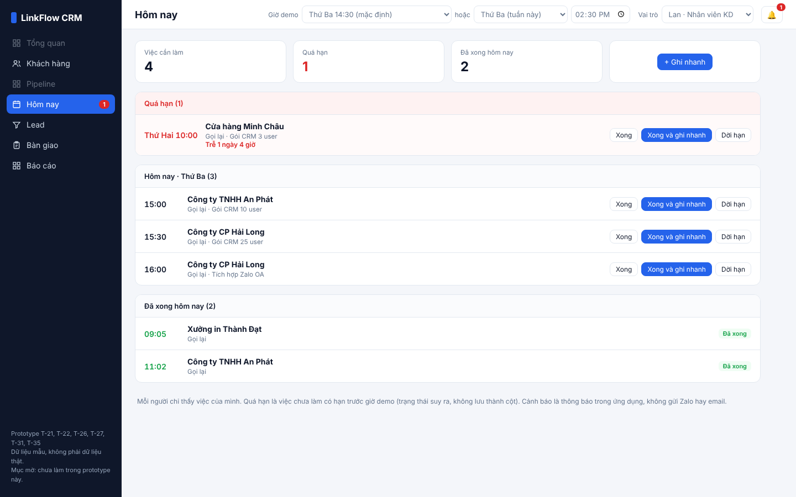
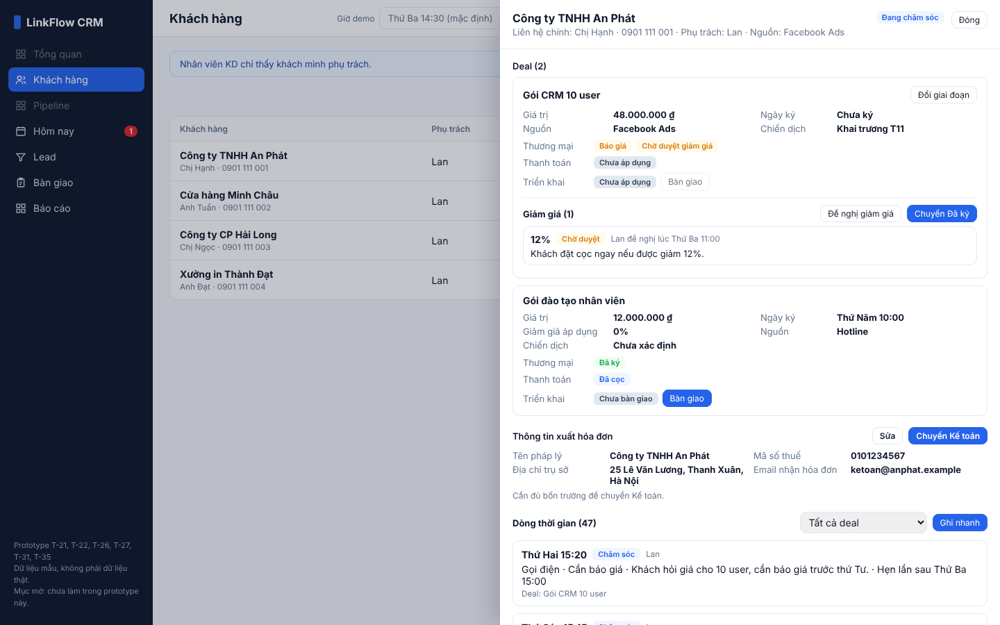
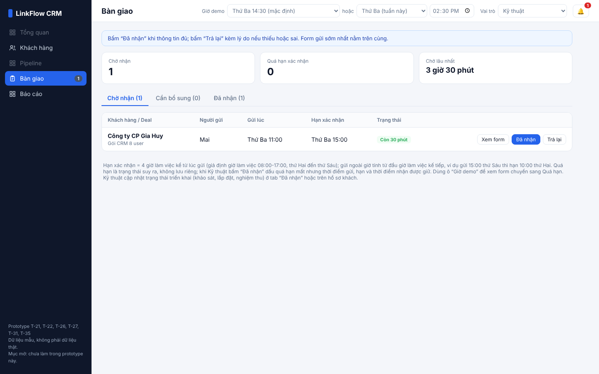
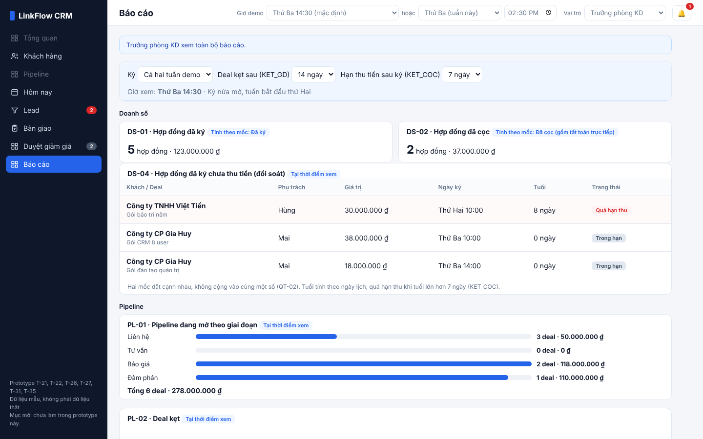

# LinkFlow CRM

**Dự án Business Analyst mô phỏng / cá nhân.** NetVina (công ty khách hàng), người dùng, số liệu và kết quả phỏng vấn trong dự án đều là giả định, dựng để thực hành trọn quy trình BA từ khơi gợi yêu cầu đến kiểm thử. Không có số liệu kinh doanh thật.

## Bài toán

NetVina là SME giả định bán Internet, camera và dịch vụ hạ tầng số cho doanh nghiệp. Marketing, Kinh doanh, Kỹ thuật, Kế toán và CSKH mỗi bộ phận dùng một công cụ riêng và bàn giao qua Zalo: lead chờ lâu, thông tin bàn giao thiếu, hóa đơn phải làm lại, số hợp đồng ký và số đã cọc lệch nhau, không ai thấy một khách đang ở bước nào.

## Giải pháp

LinkFlow CRM là CRM B2B tinh gọn đặt **một hồ sơ khách hàng thống nhất** ở giữa, với:

- **Ba dòng trạng thái độc lập** do ba bộ phận làm chủ: Thương mại (Kinh doanh), Thanh toán (Kế toán), Triển khai (Kỹ thuật).
- **Ba Handoff Gate** có trường bắt buộc, thông báo, xác nhận “Đã nhận” và SLA tính theo giờ làm việc: Marketing sang Kinh doanh, Kinh doanh sang Kỹ thuật, Kỹ thuật sang Kế toán và CSKH.
- Duyệt giảm giá có lịch sử, ghi nhanh một lần trao đổi, màn Hôm nay, báo cáo theo vai trò.

## Bắt đầu từ đâu

| Muốn xem | Mở |
|---|---|
| Tổng quan dự án trong 15 trang | `07_Tong_hop/Sprint 5_T37 Ho so du an LinkFlow CRM.pdf` |
| Chạy thử prototype | https://nhulinh654-sys.github.io/linkCRM_prj/ hoặc mở `05_Prototype/index.html` |
| Cách thao tác theo vai trò | `05_Prototype/Sprint 5_T36 User Manual.docx` |

## Thử prototype trong 3 phút

Chọn vai trò ở ô “Vai trò” trên cùng; “Giờ demo” mặc định là Thứ Ba 14:30.

1. Vai **Kỹ thuật**, mục Bàn giao: form của Gia Huy đang chờ nhận, hạn xác nhận tính 4 giờ làm việc. Thử “Đã nhận” hoặc “Trả lại”.
2. Vai **Trưởng phòng KD**, mục Duyệt giảm giá: duyệt hoặc từ chối đề nghị giảm trên 10% (từ chối phải có lý do).
3. Vai **Lan**, mục Khách hàng, mở hồ sơ An Phát: xem ba dòng trạng thái, giảm giá, hóa đơn và dòng thời gian; thử “Chuyển Đã ký”.
4. Vai **Trưởng phòng KD**, mục Báo cáo: đổi kỳ và ngưỡng deal kẹt để xem số liệu và cờ cảnh báo thay đổi.

| Hôm nay | Hồ sơ khách hàng thống nhất |
|---|---|
|  |  |
| **Bàn giao** | **Báo cáo** |
|  |  |

## Quy trình BA đã đi qua

| Bước | Thư mục | Sản phẩm |
|---|---|---|
| Khởi tạo và phạm vi | `01_Khoi_tao` | Tổng hợp khơi gợi yêu cầu (T-03), Ý tưởng dự án (T-04), Business Case (T-05), Stakeholder Register (T-06), Scope Statement (T-07), Desk research CRM (T-08) |
| Phân tích và đặc tả | `02_Phan_tich_va_yeu_cau` | BRD v1.1, 36 User Story kèm Acceptance Criteria (M1-M6), SRS các cổng bàn giao, định nghĩa chỉ số báo cáo, NFR, phân quyền, ma trận truy vết |
| Mô hình hóa | `03_Mo_hinh_hoa` | State Diagram, ERD và từ điển dữ liệu, BPMN As-Is và To-Be (file .drawio có thể chỉnh) |
| Dữ liệu và SQL | `04_Du_lieu_va_SQL` | SQL PostgreSQL cho báo cáo, dữ liệu mẫu (.xlsx, .csv) |
| Prototype | `05_Prototype` | Trang HTML tương tác, User Manual |
| Kiểm thử | `06_Kiem_thu` | 317 Test Case, 12 kịch bản UAT, kết quả UAT và nhật ký lỗi |
| Tổng hợp | `07_Tong_hop` | Hồ sơ dự án |

## Con số của dự án

| | |
|---|---|
| Pain point | 11 (9 giải quyết trong MVP) |
| Yêu cầu chức năng | 17 (15 trong MVP) |
| Business Rule | 19 |
| User Story | 36 |
| NFR có tiêu chí đo | 20 |
| Bảng trong ERD | 17 |
| Chỉ số báo cáo định nghĩa | 25 |
| Test Case / kịch bản UAT | 317 / 12 |
| UAT mô phỏng, lượt 2 | 66 trên 67 bước đạt; 1 bước chưa kiểm chứng (UAT-10, G-09) |

## Quyết định BA đáng chú ý

- Tách mốc “confirm” thành ba dòng trạng thái, để báo cáo luôn ghi rõ tính theo mốc nào.
- Dùng trường bắt buộc ở Handoff Gate thay vì nhắc việc, vì nhắc việc không chặn được thiếu thông tin.
- Tính SLA theo giờ làm việc, kể cả lead đến ngoài giờ.
- Phát hiện khi viết định nghĩa báo cáo rằng mức giảm giá áp dụng chưa được lưu, nên bổ sung ghi mức giảm khi chuyển Đã ký và kiểm theo đề nghị đã duyệt.
- Cắt các mục Should trước khi cắt Must; nhắc gia hạn để Phase 2.

## Hạn chế

- Phỏng vấn, pain point, baseline và số liệu là giả định, chưa kiểm chứng với stakeholder thật.
- Desk research dựa vào tài liệu công khai của hãng, không dùng thử sản phẩm.
- UAT chạy bằng trình duyệt tự động trên prototype; kết quả từng Test Case chưa điền.
- Prototype không có đăng nhập, bảo mật thật, thông báo Zalo hoặc email; nhập dữ liệu chỉ đọc .csv.

## Công cụ

Google Sheets (Kanban theo sprint), draw.io (BPMN, State Diagram, ERD), PostgreSQL (SQL báo cáo), HTML và JavaScript thuần (prototype), Word (tài liệu).
